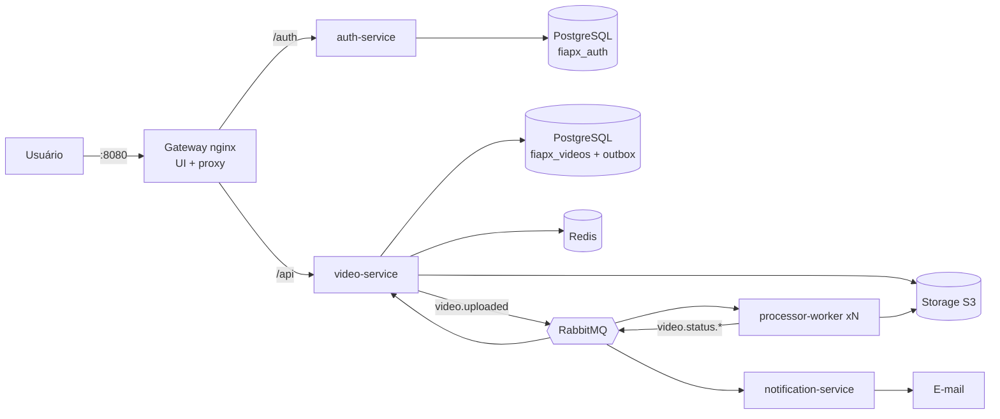

# FIAP X — Sistema de Processamento de Vídeos

[](https://github.com/monnclaro/soat-hackaton/actions/workflows/ci-cd.yml)

Hackathon POSTECH SOAT, Fase 5. O usuário envia vídeos e o sistema devolve um **.zip com os frames** de cada um (1 imagem por segundo). É uma evolução do projeto base, reescrito como **microsserviços em Go com mensageria**:
- processa vários vídeos em paralelo;
- não perde requisições em picos;
- exige login e mostra o status de cada vídeo;
- avisa o usuário por e-mail quando o processamento falha.

## Início rápido

Pré-requisito: Docker com Compose v2.

```bash
git clone https://github.com/monnclaro/soat-hackaton.git
cd soat-hackaton
docker compose up -d --build
```

| Serviço | URL | Credenciais |
|---|---|---|
| **Aplicação (UI + API)** | http://localhost:8080 | crie uma conta na tela |
| Grafana | http://localhost:3000 | `admin` / `admin` |
| RabbitMQ | http://localhost:15672 | `guest` / `guest` |
| Mailpit (e-mails) | http://localhost:8025 | — |
| Prometheus | http://localhost:9090 | — |

Outras formas de executar (serviços na mão, sem Docker, Kubernetes) estão em [docs/running.md](docs/running.md).

## Documentação

| Documento | Conteúdo |
|---|---|
| [Como executar](docs/running.md) | Docker Compose, serviços na mão, sem Docker, Kubernetes e solução de problemas |
| [Uso do sistema](docs/usage.md) | Interface web e referência da API com exemplos |
| [Arquitetura](docs/architecture.md) | Diagramas, fluxos de sequência, máquina de estados e modelo de dados |
| [Como o sistema funciona](docs/how-it-works.md) | Microsserviços, mensageria, banco, resiliência e escalabilidade |
| [Operação](docs/operations.md) | Observabilidade, Kubernetes e variáveis de ambiente |
| [Qualidade](docs/quality.md) | Testes, CI/CD e fluxo de desenvolvimento |
| [ADRs](docs/adr/README.md) | 13 decisões de arquitetura com contexto e alternativas |
| [OpenAPI](docs/openapi.yaml) | Contrato da API |
| [Script do banco](scripts/db/init.sql) | Criação dos bancos de dados |

## O problema e a solução

O projeto base (`projeto-fiapx`) era um único `main.go`:

| Problema no projeto base | Como foi resolvido |
|---|---|
| Rodava o ffmpeg **dentro da requisição HTTP**: o cliente esperava minutos e poucos uploads simultâneos derrubavam o servidor | Upload responde `202` na hora; o processamento é assíncrono via RabbitMQ |
| Gravava vídeos e ZIPs no **disco local**: impossível ter mais de uma instância | Armazenamento compatível com S3 compartilhado entre API e workers |
| **Sem autenticação**: qualquer um via os arquivos de todos | Cadastro, login e JWT; cada usuário só acessa os próprios vídeos |
| **Sem banco de dados** | PostgreSQL com o status de cada vídeo |
| Erro só aparecia na resposta HTTP | Notificação por e-mail em caso de falha |
| Sem testes, sem CI, Dockerfile com `go run` | Testes unitários, de integração e E2E, gate de cobertura, pipeline completo e imagens mínimas não-root |

## Requisitos atendidos

| Requisito | Como é atendido |
|---|---|
| Processar mais de um vídeo ao mesmo tempo | Cada worker processa N vídeos em paralelo e várias réplicas competem pela mesma fila |
| Não perder requisições em picos | Transactional outbox, publisher confirms, filas duráveis, ack só ao final, reentrega e DLQ |
| Protegido por usuário e senha | auth-service com bcrypt + JWT; todas as rotas `/api` exigem token |
| Listagem de status por usuário | `GET /api/videos`, com cache Redis |
| Notificação em caso de erro | Evento `video.status.failed` → notification-service → e-mail |
| Persistência | PostgreSQL (um banco por serviço), armazenamento S3 e Redis |
| Arquitetura escalável | Serviços stateless, mensageria, HPA no Kubernetes (KEDA opcional) |
| Testes | Unitários, integração com infra real e E2E; cobertura mínima de 80% (atual ~86%) |
| CI/CD | GitHub Actions: lint → testes → E2E → imagens no GHCR → deploy Kubernetes |

## Arquitetura



A API **aceita** o vídeo rápido e de forma durável. O **processamento** acontece depois, em workers que escalam de forma independente, e a fila entre os dois absorve os picos. Detalhes em [docs/architecture.md](docs/architecture.md) e [docs/how-it-works.md](docs/how-it-works.md).

Internamente, cada microsserviço segue **Clean Architecture**: `domain/` (entidades e regras), `usecase/` (casos de uso e as interfaces que eles exigem) e `adapter/` (HTTP, filas, banco, cache, ffmpeg, SMTP). As dependências apontam sempre para dentro, e um teste automático impede violações ([ADR 0013](docs/adr/0013-clean-architecture.md)).

## Stack

| Camada | Tecnologia |
|---|---|
| Serviços | Go 1.26 (`net/http`, `log/slog`) |
| Mensageria | RabbitMQ 4 (quorum queues, DLQ, publisher confirms) |
| Dados | PostgreSQL 17 (um banco por serviço) + Redis 7 |
| Arquivos | Armazenamento compatível com S3 (SeaweedFS self-hosted; sem dependência de nuvem) |
| Processamento | ffmpeg |
| UI | HTML + SCSS + JavaScript (módulos ES), servida por nginx 1.30 |
| Observabilidade | Prometheus + Grafana (dashboard e alertas provisionados) |
| Infraestrutura | Docker, Docker Compose, Kubernetes (Kustomize) |
| CI/CD | GitHub Actions + GHCR |

## Estrutura do repositório

```
cmd/                 entrypoints dos 4 microsserviços
internal/<serviço>/  Clean Architecture: domain/ (regras), usecase/ (casos de uso + portas), adapter/ (HTTP, filas, banco...)
internal/            também: events (contratos), platform (drivers compartilhados), archtest (regra de dependência)
web/                 UI (HTML, SCSS, módulos ES) compilada no build do gateway
deploy/              gateway, prometheus, grafana, seaweedfs, k8s (base / local / optional)
scripts/             init.sql do banco e e2e.sh
docs/                documentação, ADRs e OpenAPI
```
