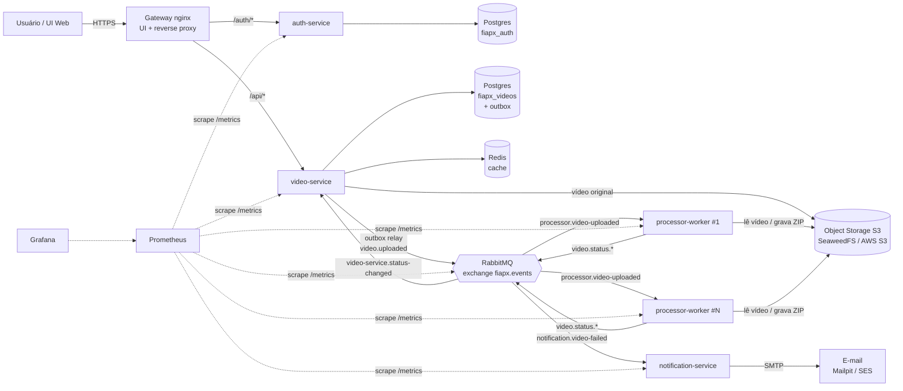
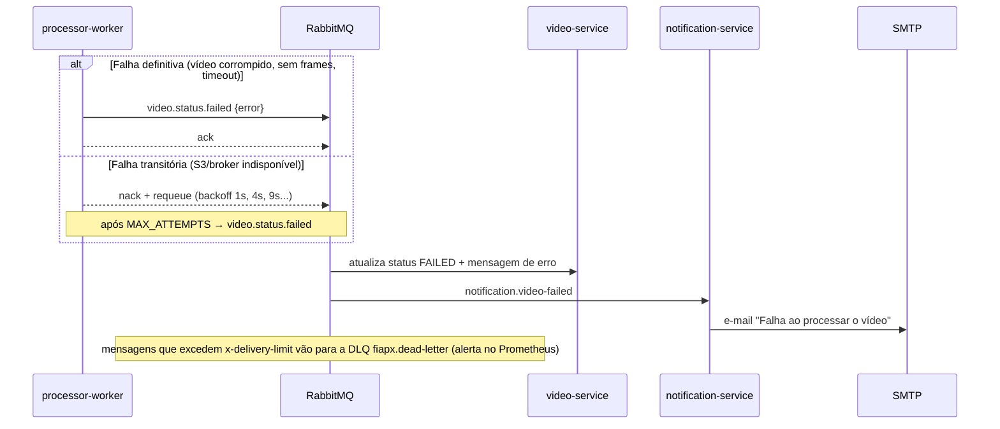
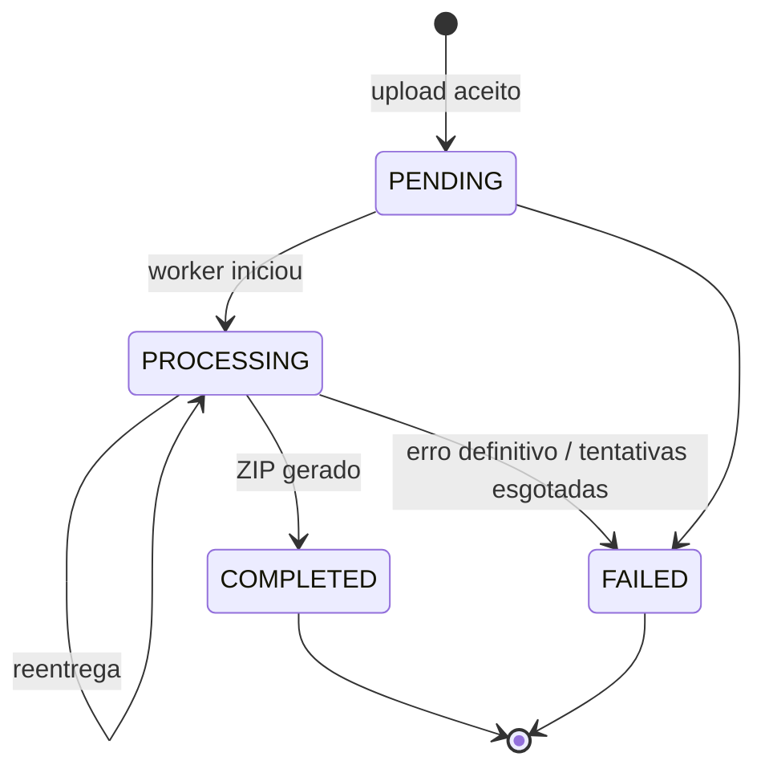
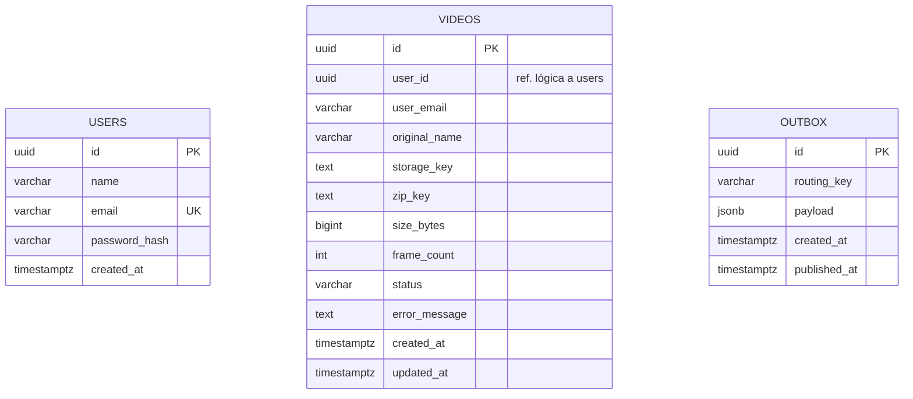

# Arquitetura — FIAP X Processamento de Vídeos

## 1. Contexto

O projeto base era um único processo Go que recebia o vídeo, rodava o ffmpeg **dentro da requisição HTTP** e gravava o ZIP no disco local. Isso impedia escalar, perdia o trabalho se o processo caísse, não tinha autenticação, persistência nem visibilidade de status.

A nova versão separa **aceitar o pedido** de **processar o vídeo**, com mensageria no meio. Cada peça escala de forma independente.

## 2. Visão geral



| Serviço | Responsabilidade | Dados | Escala |
|---|---|---|---|
| **gateway** | Ponto único de entrada, serve a UI, roteia `/auth` e `/api`, upload em streaming | — | Horizontal (stateless) |
| **auth-service** | Cadastro, login (bcrypt) e emissão de JWT | `fiapx_auth.users` | Horizontal (HPA CPU) |
| **video-service** | Upload, listagem de status, download do ZIP, outbox, consumo de status | `fiapx_videos.videos`, `outbox`, Redis, S3 | Horizontal (HPA CPU) |
| **processor-worker** | Baixa o vídeo, extrai frames (ffmpeg), gera ZIP, publica status | S3 | Horizontal (HPA CPU ou KEDA por fila) + `WORKER_CONCURRENCY` por pod |
| **notification-service** | E-mail ao usuário quando o processamento falha | — | Horizontal |

## 3. Como cada requisito é atendido

| Requisito | Solução |
|---|---|
| Processar mais de um vídeo ao mesmo tempo | Workers competem pela mesma fila. Cada pod processa `WORKER_CONCURRENCY` vídeos (prefetch = concorrência), e o HPA/KEDA adiciona pods. O compose sobe 2 réplicas × 2 = 4 vídeos simultâneos. |
| Não perder requisições em picos | (1) O upload só retorna `202` depois que o vídeo está no S3 e o registro + mensagem estão no Postgres **na mesma transação** (*transactional outbox*). (2) O relay publica com *publisher confirms* e só marca como publicada após o ack do broker. (3) As filas são **quorum queues** duráveis com mensagens persistentes. (4) O worker só dá *ack* ao terminar; se o pod morrer, a mensagem é reentregue. (5) O pico vira fila, não erro. |
| Protegido por usuário e senha | auth-service com senha em bcrypt e JWT HS256. Todas as rotas `/api/*` exigem `Authorization: Bearer`, e cada usuário só vê os próprios vídeos. |
| Listagem de status por usuário | `GET /api/videos` com cache-aside no Redis (TTL curto + invalidação a cada mudança de status). |
| Notificação em caso de erro | O worker publica `video.status.failed` e o notification-service envia o e-mail (Mailpit local; SES/SMTP em produção). |
| Persistência | PostgreSQL (database-per-service) + object storage S3 + Redis com AOF. |
| Arquitetura escalável | Serviços stateless, storage compartilhado (S3) no lugar do disco local, mensageria, HPA, KEDA opcional. |
| Testes | Unitários (domínio, casos de uso, HTTP, worker), integração com infraestrutura real (Postgres, Redis, RabbitMQ, S3) e E2E do fluxo completo. Gate de cobertura de 80% no CI. |
| CI/CD | GitHub Actions: gofmt → vet → golangci-lint → testes com race + integração → gate de cobertura → E2E → imagens no GHCR → deploy K8s. |

## 4. Fluxos

### 4.1 Upload e processamento

```mermaid
sequenceDiagram
    autonumber
    actor U as Usuário
    participant V as video-service
    participant S as S3
    participant DB as Postgres
    participant R as Outbox relay
    participant Q as RabbitMQ
    participant W as processor-worker

    U->>V: POST /api/videos (multipart, JWT)
    V->>S: PutObject (streaming)
    V->>DB: BEGIN; INSERT videos(PENDING); INSERT outbox; COMMIT
    V-->>U: 202 Accepted {id, status: PENDING}
    loop a cada 1s (ou imediatamente se o lote veio cheio)
        R->>DB: SELECT ... FOR UPDATE SKIP LOCKED
        R->>Q: publish video.uploaded (confirm)
        R->>DB: UPDATE outbox SET published_at
    end
    Q->>W: deliver (prefetch N)
    W->>Q: video.status.processing
    W->>S: GetObject → ffmpeg → zip → PutObject
    W->>Q: video.status.completed {zip_key, frame_count}
    W-->>Q: ack
    Q->>V: video.status.* → UPDATE videos + invalida cache
    U->>V: GET /api/videos (polling da UI)
    U->>V: GET /api/videos/{id}/download
    V->>S: GetObject (stream do ZIP)
```

### 4.2 Falha e notificação



### 4.3 Máquina de estados do vídeo



`COMPLETED` e `FAILED` são terminais: eventos duplicados ou fora de ordem são ignorados, então o consumidor é idempotente.

## 5. Mensageria

| Elemento | Tipo | Binding |
|---|---|---|
| `fiapx.events` | exchange topic | — |
| `processor.video-uploaded` | quorum queue, DLX, delivery-limit | `video.uploaded` |
| `video-service.status-changed` | quorum queue, DLX, delivery-limit | `video.status.*` |
| `notification.video-failed` | quorum queue, DLX, delivery-limit | `video.status.failed` |
| `fiapx.dlx` → `fiapx.dead-letter` | exchange topic + quorum queue | `#` |

Contratos em [internal/events/events.go](../internal/events/events.go). Garantia *at-least-once*: os consumidores são idempotentes (máquina de estados no video-service e chave de objeto determinística no worker).

## 6. Modelo de dados



`users` fica no banco `fiapx_auth`; `videos` e `outbox` ficam em `fiapx_videos` (database-per-service, sem FK entre bancos). O script de criação está em [scripts/db/init.sql](../scripts/db/init.sql).

## 7. Organização do código (Clean / Hexagonal)

```
cmd/<serviço>/main.go          composição (wiring) e ciclo de vida
internal/<contexto>/
  domain.go / service.go       regras e casos de uso (dependem só de interfaces/portas)
  handler.go / async.go        adaptadores de entrada (HTTP, consumidores)
  postgres.go / cache.go       adaptadores de saída
internal/events                contratos de mensagens
internal/platform              infraestrutura compartilhada (httpx, rabbitmq, postgres, storage, security, config)
```

## 8. Observabilidade

- **Métricas** (Prometheus, `/metrics` em cada serviço): `http_requests_total`, `http_request_duration_seconds`, `fiapx_video_uploads_total`, `fiapx_processor_jobs_total{result}`, `fiapx_processor_job_duration_seconds`, `fiapx_processor_jobs_in_flight`, `fiapx_notifications_total`, além das métricas de filas do RabbitMQ (`:15692`).
- **Dashboard** Grafana provisionado: *FIAP X - Processamento de Vídeos*.
- **Alertas**: backlog da fila, mensagens na DLQ, taxa de falhas > 20%, serviço fora do ar ([deploy/prometheus/alerts.yml](../deploy/prometheus/alerts.yml)).
- **Logs** estruturados em JSON (slog) com `service`, `video_id` e `attempt`.
- **Health**: `/healthz` (liveness) e `/readyz` (readiness checa as dependências).

## 9. Decisões (ADRs resumidas)

Versão completa (contexto, alternativas descartadas e consequências) em [docs/adr](./adr/README.md).

| # | Decisão | Motivo | Trade-off |
|---|---|---|---|
| 1 | Go + `net/http` da stdlib | Mesmo stack do projeto base; roteamento com padrões já existe no Go 1.22+ | Menos "açúcar" que gin |
| 2 | RabbitMQ com quorum queues | Ack manual, DLX, delivery-limit e replicação; adequado a filas de trabalho | Kafka seria melhor para replay/streams, mas é mais pesado de operar |
| 3 | Transactional outbox | Evita *dual write* (DB ok, broker fora), que perderia o pedido | Latência extra de até 1s para enfileirar |
| 4 | Object storage S3 em vez de disco | Workers e API em máquinas diferentes compartilham arquivos; escala | Mais um componente (SeaweedFS local; AWS S3 em produção) |
| 5 | Upload em streaming (multipart → S3) | Não bufferiza vídeos de GB em memória/disco da API | — |
| 6 | Database-per-service | Baixo acoplamento entre auth e vídeos | `user_email` é desnormalizado no vídeo para a notificação |
| 7 | JWT stateless com segredo compartilhado | Qualquer réplica valida sem consultar o auth-service | Revogação só por expiração (TTL 24h configurável) |
| 8 | Redis cache-aside com TTL curto | Polling frequente da UI não sobrecarrega o Postgres | Janela de até `CACHE_TTL` de dado obsoleto numa corrida rara |
| 9 | Crash-only nos consumidores | Perda de conexão com o broker encerra o processo e o orquestrador reinicia | Reinício em vez de reconexão in-process |
| 10 | SeaweedFS no ambiente local | O MinIO deixou de publicar imagens públicas; o SeaweedFS é S3-compatível e mantido | — |

## 10. Produção (AWS, sugestão)

EKS (manifests em `deploy/k8s/base`), RDS PostgreSQL, ElastiCache Redis, Amazon MQ for RabbitMQ, S3, SES (SMTP) e Prometheus/Grafana (ou Amazon Managed Prometheus/Grafana). A troca é só de configuração: endpoints e credenciais nos Secrets.
