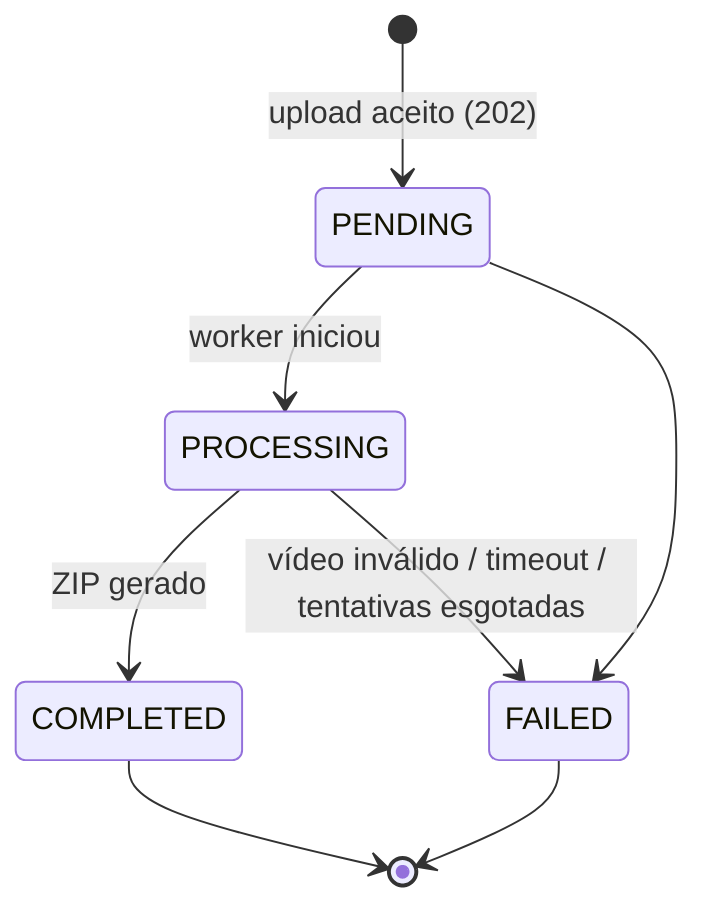

# Como o sistema funciona

- [Microsserviços](#microsserviços)
- [Ciclo de vida de um vídeo](#ciclo-de-vida-de-um-vídeo)
- [Mensageria](#mensageria)
- [Banco de dados](#banco-de-dados)
- [Resiliência](#resiliência-o-que-acontece-quando-algo-falha)
- [Escalabilidade](#escalabilidade)

Diagramas de arquitetura, sequência e modelo de dados em [architecture.md](architecture.md); justificativas das decisões em [adr/](adr/README.md).

## Microsserviços

### gateway (nginx)
- Ponto único de entrada na porta **8080**; serve a **UI web** (`web/`: HTML + SCSS + módulos ES, compilada no build da imagem).
- Roteia `/auth/*` → auth-service e `/api/*` → video-service.
- Upload em **streaming** (`proxy_request_buffering off`), limite de 1 GiB.
- Re-resolve o DNS dos serviços a cada 10s, então réplicas novas entram no balanceamento.

### auth-service ([internal/auth](../internal/auth))
- `POST /auth/register`, `POST /auth/login`, `GET /auth/me`.
- Senhas com **bcrypt**; e-mail normalizado (minúsculas, sem espaços) e único.
- Emite **JWT HS256** com `sub`, `email`, `name` e expiração (24h por padrão).
- Banco: `fiapx_auth.users`.

### video-service ([internal/video](../internal/video))
- `POST /api/videos`: recebe o multipart e faz **stream direto para o S3**, sem guardar em disco ou memória. Grava vídeo + mensagem de outbox na **mesma transação** e responde `202`.
- `GET /api/videos`: lista os vídeos do usuário (**cache Redis**, TTL 30s, invalidado a cada mudança).
- `GET /api/videos/{id}` e `GET /api/videos/{id}/download`: stream do ZIP.
- **Outbox relay**: publica as mensagens pendentes no RabbitMQ com confirmação do broker.
- **Consumidor** `video.status.*`: atualiza o status respeitando a máquina de estados (idempotente).
- Banco: `fiapx_videos.videos` e `fiapx_videos.outbox`.

### processor-worker ([internal/processor](../internal/processor))
- Consome `processor.video-uploaded` com `WORKER_CONCURRENCY` goroutines.
- Para cada vídeo: publica `PROCESSING`, baixa do S3 para um diretório temporário, roda `ffmpeg -vf fps=1` (PNG), compacta, envia o ZIP ao S3 e publica `COMPLETED` (ou `FAILED`).
- Diferencia **falha definitiva** (vídeo inválido, sem frames, timeout), que marca `FAILED`, de **falha transitória** (S3 ou broker), que gera retentativa com backoff.
- Graceful shutdown: termina os vídeos em andamento antes de sair.

### notification-service ([internal/notification](../internal/notification))
- Consome `notification.video-failed` e envia um e-mail com o nome do arquivo, o motivo e o ID do vídeo.
- SMTP configurável: Mailpit no ambiente local, qualquer servidor ou provedor SMTP em produção.

---

## Ciclo de vida de um vídeo



1. **Upload**: o vídeo vai para o S3 em `videos/<user>/<id>.<ext>`; a linha em `videos` (PENDING) e a mensagem em `outbox` são gravadas na mesma transação.
2. **Outbox relay** (a cada 1s, ou imediatamente sob carga): publica `video.uploaded` e marca a mensagem como publicada.
3. **Worker**: publica `PROCESSING`, extrai os frames, gera o ZIP em `outputs/<user>/<id>.zip` e publica `COMPLETED` com `frame_count`.
4. **video-service**: consome o evento, atualiza o banco e invalida o cache.
5. **Em caso de falha**: o worker publica `FAILED` com o motivo, o video-service grava o erro e o notification-service envia o e-mail.

Os estados `COMPLETED` e `FAILED` são **terminais**: eventos duplicados ou atrasados são ignorados.

---

## Mensageria

Exchange **`fiapx.events`** (topic). Todas as filas são **quorum queues** com dead-letter para `fiapx.dlx` e `x-delivery-limit` configurável.

| Fila | Routing key | Produtor | Consumidor |
|---|---|---|---|
| `processor.video-uploaded` | `video.uploaded` | video-service (outbox) | processor-worker |
| `video-service.status-changed` | `video.status.*` | processor-worker | video-service |
| `notification.video-failed` | `video.status.failed` | processor-worker | notification-service |
| `fiapx.dead-letter` | `#` (via `fiapx.dlx`) | RabbitMQ | operação (análise manual) |

Contratos em [internal/events/events.go](../internal/events/events.go). Exemplo de `video.status.failed`:

```json
{
  "video_id": "a1b2…", "user_id": "0b6c…", "user_email": "ana@fiapx.com", "user_name": "Ana",
  "original_name": "corrompido.mp4", "status": "FAILED",
  "error": "ffmpeg não conseguiu processar o vídeo: …", "occurred_at": "2026-11-11T22:03:55Z"
}
```

Você pode inspecionar as filas, as mensagens e a DLQ no **RabbitMQ Management** (http://localhost:15672 → *Queues*).

---

## Banco de dados

**Database-per-service** ([ADR 0005](adr/0005-database-per-service.md)):

| Banco | Dono | Tabelas |
|---|---|---|
| `fiapx_auth` | auth-service | `users` (id, name, email único, password_hash bcrypt, created_at) |
| `fiapx_videos` | video-service | `videos` (status, chaves no S3, tamanho, frames, erro, datas); `outbox` (mensagens a publicar) |

- **Script de criação:** [scripts/db/init.sql](../scripts/db/init.sql). O container do Postgres o executa automaticamente na primeira subida.
- **Migrações automáticas:** cada serviço também aplica o seu DDL idempotente (`internal/*/migrations.sql`) ao iniciar, com `pg_advisory_lock` para várias réplicas. Isso permite usar um PostgreSQL gerenciado (de qualquer provedor) sem rodar o script manualmente.

Para consultar:
```bash
docker compose exec postgres psql -U fiapx -d fiapx_videos \
  -c "SELECT original_name, status, frame_count, error_message FROM videos ORDER BY created_at DESC LIMIT 10;"
```

---

## Resiliência: o que acontece quando algo falha

| Cenário | Comportamento |
|---|---|
| **Pico de uploads** | A API só grava e responde `202`; os vídeos se acumulam na fila e os workers drenam no ritmo deles. Nada é rejeitado por falta de capacidade de processamento. |
| **RabbitMQ fora do ar no upload** | O upload continua funcionando: a mensagem fica no `outbox` e o relay publica quando o broker voltar. |
| **Worker morre no meio de um vídeo** | A mensagem não recebeu ack, então o RabbitMQ a reentrega a outra réplica. |
| **Deploy / scale-down do worker** | SIGTERM: o worker para de pegar vídeos novos e termina os atuais (até 10 min no K8s). |
| **Vídeo corrompido** | ffmpeg falha, o status vira `FAILED` com o motivo e o usuário recebe e-mail. Não há retentativa, porque não adiantaria. |
| **S3 instável durante o processamento** | Retentativa com backoff (1s, 4s, 9s...); após `MAX_ATTEMPTS`, o status vira `FAILED`. Nunca fica preso em `PROCESSING`. |
| **SMTP fora do ar** | E-mail reentregue com backoff; após o limite, vai para a DLQ. O processamento não é afetado. |
| **Mensagem malformada** | Vai direto para a DLQ (alerta no Prometheus). |
| **Mensagem duplicada** | Consumidores idempotentes: a máquina de estados ignora duplicatas e o ZIP tem chave determinística. |
| **Redis fora do ar** | A listagem ignora o cache e lê do Postgres; o pod continua recebendo tráfego (o Redis não entra no readiness). |
| **Conexão com o RabbitMQ cai** | O serviço encerra (crash-only) e o Docker/Kubernetes o reinicia. |

Detalhes em [ADR 0008](adr/0008-retentativas-dlq-e-idempotencia.md).

---

## Escalabilidade

| Componente | Como escala |
|---|---|
| processor-worker | `WORKER_CONCURRENCY` por pod × número de réplicas. Compose: `--scale processor-worker=N`. K8s: HPA por CPU (2–10) ou KEDA pela fila |
| video-service | Stateless; várias réplicas (HPA 2–6). O outbox relay usa `SKIP LOCKED` e roda em todas sem duplicar |
| auth-service | Stateless; JWT validado localmente (HPA 2–5) |
| gateway | Stateless; 2 réplicas no K8s |
| Postgres/Redis/RabbitMQ/S3 | Self-hosted no próprio cluster (padrão) ou serviços gerenciados de qualquer provedor, trocando só a configuração |

**Demonstração de paralelismo:** envie vários vídeos pela UI e rode `docker compose logs -f processor-worker`. Cada réplica (`processor-worker-1`, `-2`) processa vídeos diferentes ao mesmo tempo. O painel *Vídeos em processamento agora* do Grafana mostra o total.
