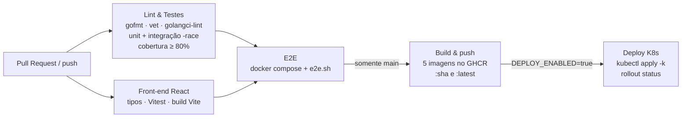

# Qualidade: testes, CI/CD e desenvolvimento

- [Testes](#testes)
- [CI/CD](#cicd)
- [Fluxo de desenvolvimento](#fluxo-de-desenvolvimento)

## Testes

| Tipo | O que cobre | Como rodar |
|---|---|---|
| **Unitários** | Por camada: `domain` (máquina de estados, validações, política de retentativa), `usecase` com fakes das portas (sucesso, falha definitiva/transitória, timeout, concorrência), `adapter` (handlers HTTP com `httptest`, consumidores, publisher, ffmpeg, ZIP, SMTP, bcrypt, JWT) e middlewares | `go test ./...` |
| **Arquitetura** | Regra de dependência da Clean Architecture: `domain` e `usecase` não importam adaptadores nem bibliotecas de infraestrutura ([internal/archtest](../internal/archtest/arch_test.go)) | `go test ./internal/archtest/` |
| **Integração** | Adaptadores contra infraestrutura **real**: repositórios Postgres e outbox, cache Redis, storage S3, publish/consume/requeue no RabbitMQ | ver abaixo |
| **Front-end** | Componentes React com Vitest + Testing Library: login e cadastro (com login automático), validação dos campos, sessão salva e expirada, contadores, envio paralelo com progresso, recusa de arquivos inválidos, download e erros da API; mais checagem de tipos TypeScript | `cd web && npm test` |
| **E2E** | Fluxo completo pelo gateway: cadastro, login, 401 sem token, 3 uploads em paralelo + 1 corrompido, processamento, ZIP com frames, `409` ao baixar vídeo com falha, e-mail no Mailpit | `./scripts/e2e.sh` |

```bash
# Unitários
go test ./...

# Unitários + integração com cobertura
docker compose up -d --wait postgres redis rabbitmq s3
go test -tags=integration -coverpkg=./internal/... -coverprofile=coverage.out ./...
go tool cover -func=coverage.out | tail -1        # total (gate do CI: 80%)
go tool cover -html=coverage.out                   # relatório navegável

# Ponta a ponta (sistema completo no ar)
docker compose up -d --build
./scripts/e2e.sh                                   # requer bash, curl e unzip
```

**Ferramentas de qualidade no CI:** `gofmt`, `go vet`, `golangci-lint`, race detector (`-race`) e gate de cobertura.

---

## CI/CD

Workflow: [.github/workflows/ci-cd.yml](../.github/workflows/ci-cd.yml).



| Job | Quando | O que faz |
|---|---|---|
| **Lint & Testes** | PR e push | formatação, vet, golangci-lint, sobe Postgres/Redis/RabbitMQ/S3, testes com `-race` e integração, publica `coverage.out`, **falha abaixo de 80%** |
| **Front-end (React)** | PR e push | `npm ci`, checagem de tipos TypeScript, testes Vitest e build de produção do Vite |
| **E2E** | após os dois anteriores | sobe o sistema completo (inclusive o build do front-end) e executa `scripts/e2e.sh`; em caso de falha, imprime os logs |
| **Imagens** | push na `main` | build multi-stage e push de `auth-service`, `video-service`, `processor-worker`, `notification-service` e `gateway` para `ghcr.io/monnclaro/soat-hackaton/*` |
| **Deploy** | push na `main` + variável `DEPLOY_ENABLED=true` | fixa as imagens na SHA do commit, aplica `deploy/k8s/base` e aguarda o rollout |

**Para habilitar o deploy:** em *Settings → Secrets and variables → Actions*, crie a variável `DEPLOY_ENABLED=true` e o secret `KUBE_CONFIG` com o kubeconfig do cluster em base64 (`base64 -w0 ~/.kube/config`).

**Imagens:** multi-stage. Os serviços usam `distroless/static` (sem shell, usuário não-root UID 65532); o worker usa `alpine` com ffmpeg e usuário não-root; o gateway compila a UI num estágio Node e serve com nginx.

---

## Fluxo de desenvolvimento

Para rodar os serviços na sua máquina, veja a [opção B de running.md](running.md#opção-b--serviços-go-na-mão--infraestrutura-no-docker). Comandos usados antes de abrir um PR (os mesmos do CI):

```bash
gofmt -l .                                   # lista arquivos não formatados (gofmt -w . corrige)
go vet ./...                                 # análise estática
go run github.com/golangci/golangci-lint/v2/cmd/golangci-lint@v2.5.0 run ./...
go test ./...                                # testes unitários
docker compose up -d --wait postgres redis rabbitmq s3
go test -tags=integration ./...              # unitários + integração
go build ./...                               # compila os 4 serviços
```

Para compilar binários: `go build -o bin/ ./cmd/...` (gera `bin/auth-service`, `bin/video-service` etc.).

**Front-end (`web/`)**: requer Node.js 22+. Com o backend no ar (opção A ou B), suba o servidor de desenvolvimento do Vite, que recarrega a tela a cada alteração e encaminha `/auth` e `/api` para o gateway em `localhost:8080`:

```bash
cd web
npm ci
npm run dev          # http://localhost:5173 (recarga instantânea)
npm test             # testes de componentes (Vitest)
npm run typecheck    # checagem de tipos
npm run build        # build de produção em web/dist
```

Para apontar a outro endereço, use `API_URL` (ex.: `API_URL=http://localhost:8082 npm run dev`). No Compose, para ver as alterações na imagem, reconstrua o gateway: `docker compose up -d --build gateway`.

Estrutura do `web/src`, organizada **por funcionalidade** (feature-based):

```
main.tsx                 ponto de entrada (monta o React e importa os estilos)
app/                     composição da aplicação
  App.tsx                providers globais + escolha entre login e área logada
  Topbar.tsx             barra superior (usuário logado, sair)
features/
  auth/                  identidade
    index.ts             API pública da feature (AuthPage, SessionProvider, useSession)
    api.ts  types.ts     chamadas /auth/* e tipos (User, LoginResponse)
    session.tsx          sessão (token + usuário no localStorage)
    hooks/useFormSubmit  validação e envio de formulários
    components/          AuthPage, LoginForm, RegisterForm, PasswordField
  videos/                vídeos
    index.ts             API pública da feature (Dashboard)
    api.ts  types.ts     chamadas /api/videos/* (lista, upload com progresso, download) e tipos
    hooks/useVideos      listagem com atualização automática e detecção de mudança de status
    lib/files            validação de arquivos e nome do ZIP
    components/          Dashboard, Stats, UploadPanel, VideoList, VideoCard
shared/                  código reutilizável, sem regra de negócio
  api/http.ts            request, ApiError, cabeçalho de autenticação
  toast/                 ToastProvider (avisos)
  lib/format.ts          bytes, tempo relativo, iniciais
styles/                  SCSS (tokens de tema claro/escuro, mixins, componentes)
test/                    setup, simulações de fetch/XMLHttpRequest e teste de arquitetura
```

Regras de dependência (verificadas por `src/test/architecture.test.ts`, que roda com os demais testes):
- `app/` pode usar `features/` e `shared/`;
- uma feature usa outra **só pela API pública** (`@/features/auth`), nunca por arquivos internos;
- `shared/` não depende de `features/` nem de `app/`.

Imports usam o alias `@/` (= `src/`), configurado em `tsconfig.json` e `vite.config.ts`. Os testes ficam ao lado do código que testam (`*.test.ts(x)`).
